# 🤖 Automated Drilling and Assembly Line using ROS 2 and Gazebo

A simulated automated industrial assembly line built with **ROS 2 Humble** and **Gazebo Classic 11**. The project demonstrates an integrated manufacturing workflow: conveyor-based workpiece transport, sensor-based detection, automated robotic drilling, and robotic pick-and-place into a collection trolley.

Two coordinated industrial robots work together:

| Robot | Role |
|---|---|
| **Robot 1** | Picks the drilled workpiece and places it into the collection trolley. |
| **Robot 2** | Performs a two-point drilling sequence on the workpiece. |

---

## 📑 Table of Contents

- [Highlights](#-highlights)
- [Performance](#-performance)
- [Project Demonstration](#-project-demonstration)
- [System Workflow](#-system-workflow)
- [ROS 2 Communication](#-ros-2-communication)
- [Technologies Used](#-technologies-used)
- [Prerequisites](#-prerequisites)
- [Installation and Execution](#-installation-and-execution)
- [Project Structure](#-project-structure)
- [Simulation Note](#-simulation-note)
- [Project Objective](#-project-objective)

---

## ✨ Highlights

- Two coordinated industrial robots working in a single simulated cell.
- Conveyor transport with sensor-based workpiece detection and automatic stopping.
- Automated **two-point drilling** by Robot 2, followed by a return to its HOME position.
- Signal-based coordination between drilling completion and pick-and-place.
- Gripper-controlled pickup and release by Robot 1 using a custom C++ Gazebo plugin.
- Automatic placement into a collection trolley.
- Continuous workpiece spawning, so the cycle repeats without manual intervention.

---

## 📊 Performance

| Metric | Result |
|---|---|
| **Drilling accuracy** | **94%** |

Drilling accuracy is tracked with the `position_accuracy_monitor.py` node, which compares the drill position reached by Robot 2 against the target drilling points.

---

## 📸 Project Demonstration

The following screenshots show the simulation and automated operations in sequence.

### 1. Complete Assembly Line Setup

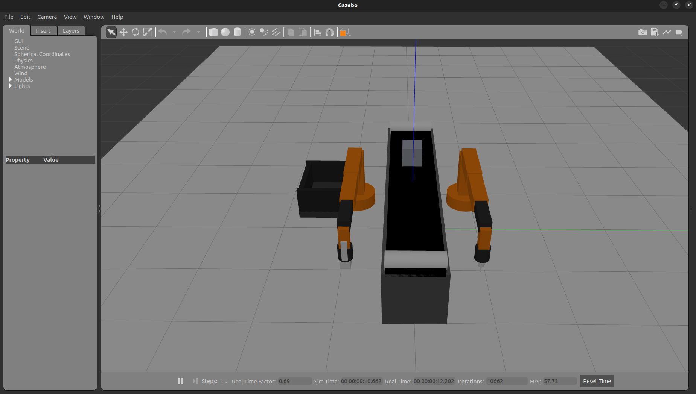

### 2. Simulation Startup

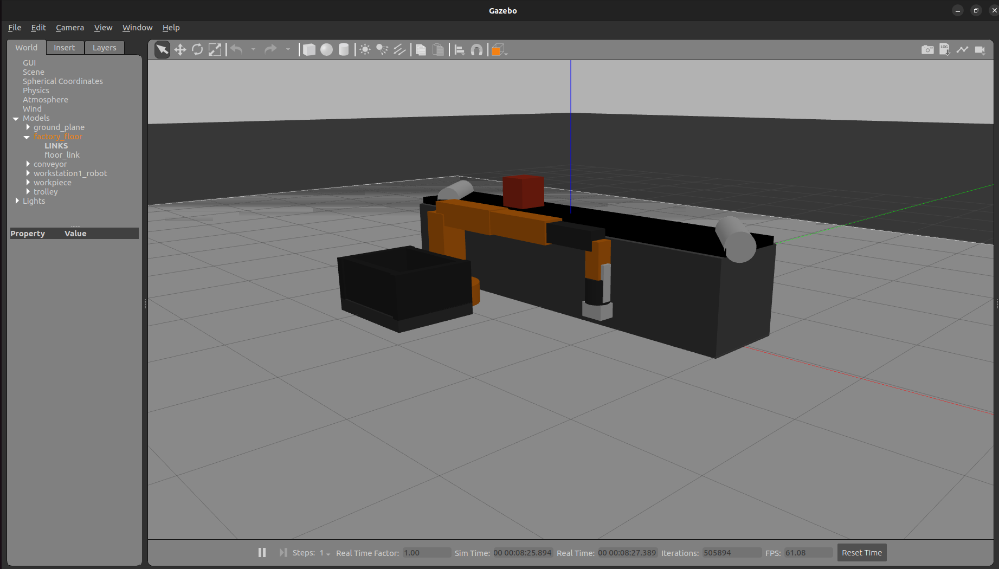

### 3. Conveyor-Based Workpiece Transportation

The conveyor transports workpieces toward the sensor detection area.

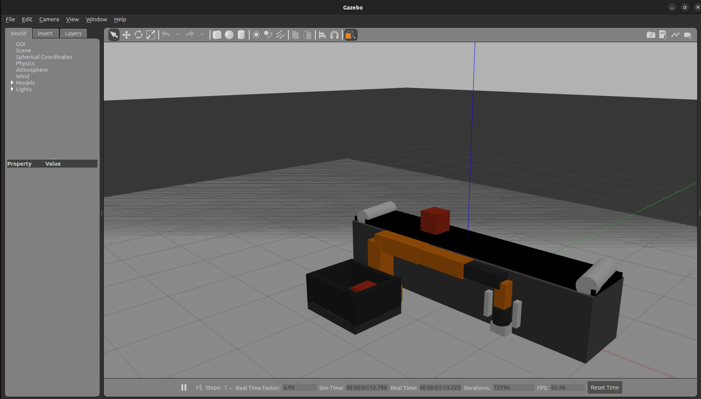

### 4. Robot 2 – First Drilling Operation

Robot 2 moves toward the first designated drilling position.

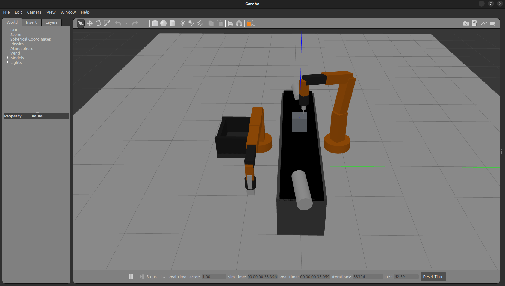

### 5. Robot 2 – Second Drilling Operation

After completing the first drilling motion, Robot 2 moves to the second designated drilling position.

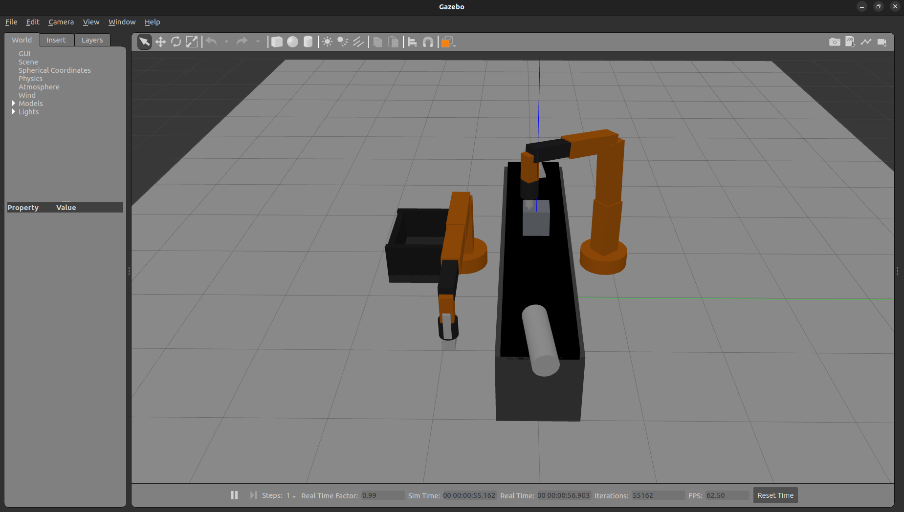

### 6. Workpiece After Two-Point Drilling

The workpiece displays the final result with exactly two holes after Robot 2 completes both drilling operations.

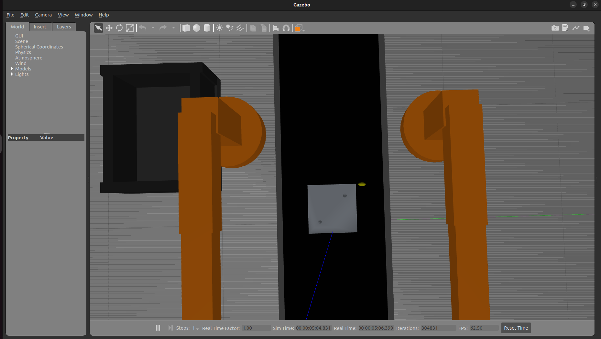

### 7. Second Workpiece After Drilling

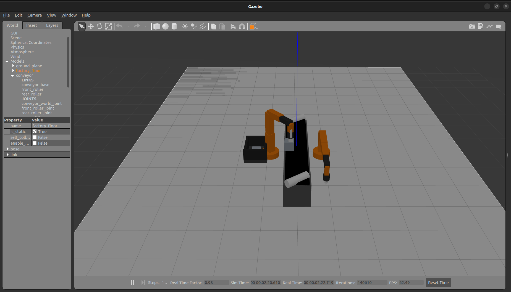

### 8. Robot 2 Returns to HOME Position

After completing the drilling sequence, Robot 2 returns to its HOME position.

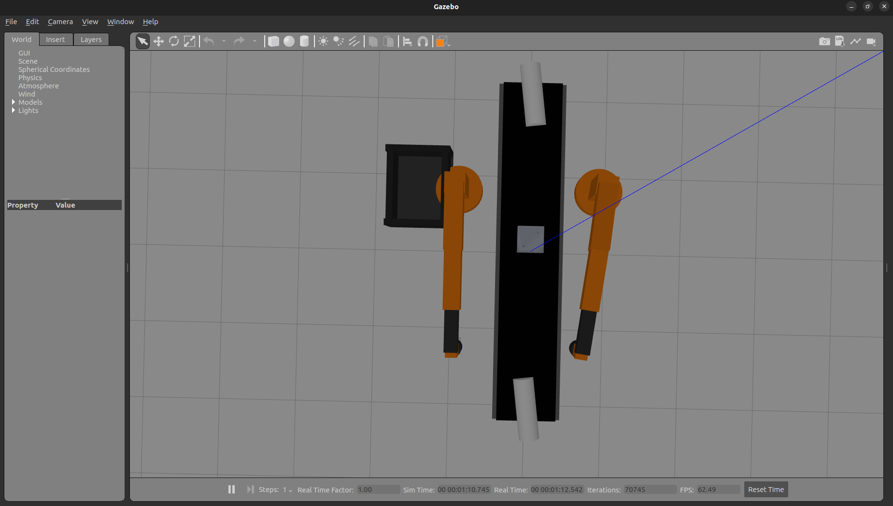

### 9. Robot 1 Picks the Drilled Workpiece

After receiving the drilling completion signal, Robot 1 starts the pick-and-place operation.

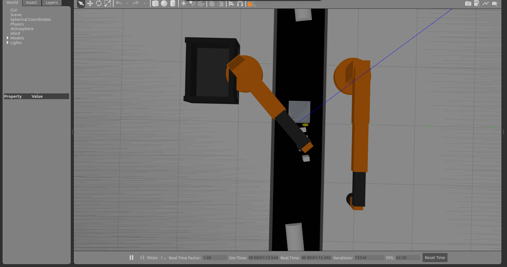

### 10. Robot 1 – Pick Operation

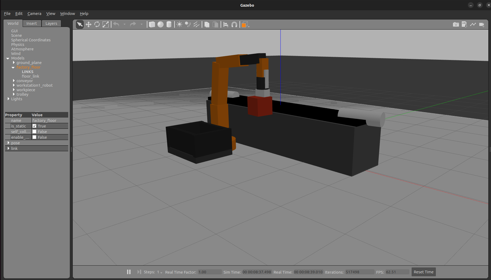

### 11. Workpiece Placement into Collection Trolley

Robot 1 transports the processed workpiece and releases it into the collection trolley.

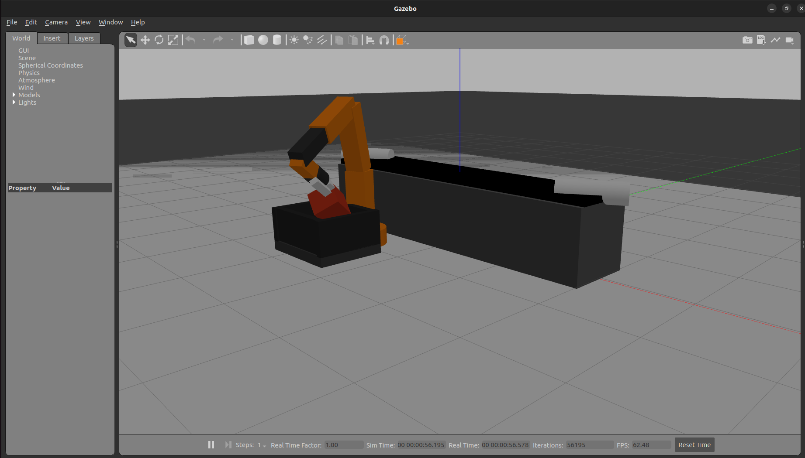

### 12. Completed Pick-and-Place Operation

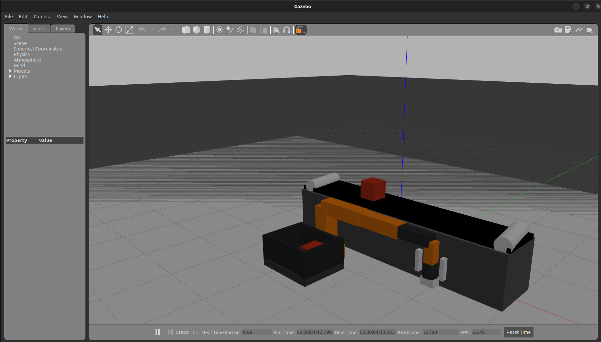

### 13. Repeated Workpiece Handling

The system continues the automated cycle with subsequent workpieces.

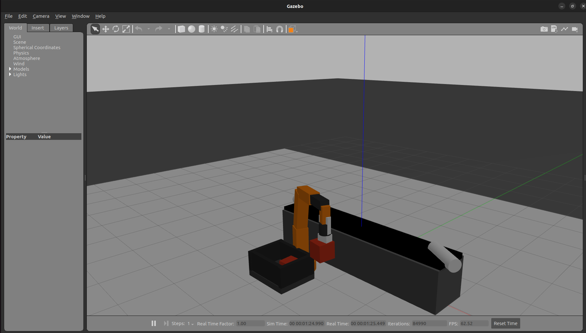

---

## 🏗️ System Workflow

The flowchart below shows the complete automated cycle, grouped by the component responsible for each stage.

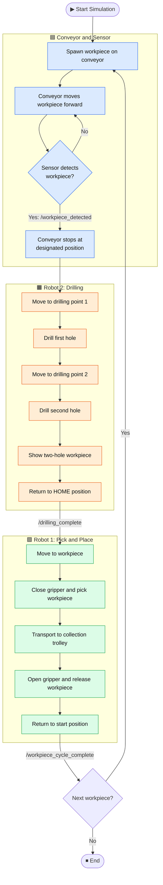

### Stage Summary

| Stage | Responsible Component | Output / Signal |
|---|---|---|
| Transport and detection | Conveyor and workpiece sensor | `/workpiece_detected` |
| Two-point drilling | Robot 2 | `/drilling_complete` |
| Pick and place | Robot 1 | `/workpiece_cycle_complete` |

---

## 🔄 ROS 2 Communication

Components communicate and coordinate through ROS 2 topics and action interfaces.

| Topic | Purpose |
|---|---|
| `/workpiece_detected` | Indicates workpiece detection by the sensor. |
| `/drilling_complete` | Indicates completion of Robot 2's drilling sequence. |
| `/workpiece_cycle_complete` | Indicates completion of the pick-and-place cycle. |

Robot motion is controlled through ROS 2 joint trajectory actions, while the conveyor and gripper use their own controllers.

---

## 🛠️ Technologies Used

| Component | Technology |
|---|---|
| Operating System | Ubuntu 22.04 |
| Robotics Middleware | ROS 2 Humble |
| Simulation Environment | Gazebo Classic 11 |
| Programming Languages | Python, C++ |
| Robot Description | URDF / Xacro |
| Robot Control | ROS 2 Controllers |
| Motion Control | Joint Trajectory Actions |
| Simulation Control | Gazebo ROS 2 Control |
| Communication | ROS 2 Topics and Actions |
| 3D Workpiece Model | STL / SDF |
| Custom Gazebo Plugin | C++ (gripper hold plugin) |

---

## 📋 Prerequisites

Make sure the following are installed:

- Ubuntu 22.04
- ROS 2 Humble
- Gazebo Classic 11
- `gazebo_ros`
- `gazebo_ros2_control`
- `ros2_control`
- `ros2_controllers`
- `xacro`
- Any other ROS 2 message and controller packages used by the project

> **Important:** This project uses a compatible custom-built `gazebo_ros2_control` installation (version 0.4.12, Humble branch) to control both robots simultaneously. It also uses a custom Gazebo gripper plugin, which must be built and installed before launching the simulation.

---

## 🚀 Installation and Execution

### 1. Clone the repository

```bash
mkdir -p ~/ros2_automated_drilling_ws/src
cd ~/ros2_automated_drilling_ws/src

git clone https://github.com/prachikale05/ros2-automated-drilling-assembly-line.git assembly_line
```

### 2. Source ROS 2 Humble

```bash
source /opt/ros/humble/setup.bash
```

### 3. Source the custom Gazebo ROS 2 Control workspace

Make sure the compatible custom `gazebo_ros2_control` workspace has already been built and installed.

```bash
source ~/gazebo_ros2_control_ws/install/setup.bash
```

### 4. Install dependencies

```bash
cd ~/ros2_automated_drilling_ws
rosdep install --from-paths src --ignore-src -r -y
```

### 5. Build the ROS 2 package

```bash
colcon build --symlink-install --packages-select assembly_line
```

### 6. Build the custom gripper plugin

The custom C++ Gazebo plugin handles workpiece attachment and release during gripper operations.

Configure and build the plugin:

```bash
cmake -S ~/ros2_automated_drilling_ws/src/assembly_line/plugins \
-B ~/ros2_automated_drilling_ws/src/assembly_line/plugins/build \
-DCMAKE_INSTALL_PREFIX=~/ros2_automated_drilling_ws/install/assembly_line/share/assembly_line
```

```bash
cmake --build ~/ros2_automated_drilling_ws/src/assembly_line/plugins/build -j$(nproc)
```

Install the plugin:

```bash
cmake --install ~/ros2_automated_drilling_ws/src/assembly_line/plugins/build
```

### 7. Source the workspace

```bash
source ~/ros2_automated_drilling_ws/install/setup.bash
```

### 8. Launch the simulation

```bash
ros2 launch assembly_line factory.launch.py
```

Gazebo starts the simulated assembly line and initializes the coordinated robot operations.

---

## 📁 Project Structure

```text
assembly_line/
├── assembly_line/                     # ROS 2 Python nodes
│   ├── automatic_pick_place.py        # Robot 1 pick-and-place logic
│   ├── drilling_controller.py         # Robot 2 two-point drilling sequence
│   ├── workpiece_controller.py        # Workpiece management
│   ├── workpiece_sensor.py            # Workpiece detection
│   ├── conveyor_workpiece.py          # Conveyor and workpiece handling
│   └── position_accuracy_monitor.py   # Drilling accuracy monitoring
│
├── config/                            # Controller configurations
│   ├── conveyor_controllers.yaml
│   ├── conveyor_velocity_controller.yaml
│   ├── drilling_robot_controllers.yaml
│   └── robot_controllers.yaml
│
├── description/                       # Robot and conveyor descriptions
│   ├── conveyor.urdf.xacro
│   └── robot/
│       ├── industrial_robot.urdf.xacro
│       └── drilling_robot.urdf.xacro
│
├── launch/
│   ├── factory.launch.py              # Main launch file
│   └── robot.launch.py
│
├── models/                            # Gazebo models
│   ├── conveyor/
│   ├── trolley/
│   ├── workpiece/
│   └── workstation1/
│
├── plugins/                           # Custom C++ Gazebo plugin
│   ├── CMakeLists.txt
│   └── gripper_hold_plugin.cpp
│
├── worlds/
│   └── factory.world
│
├── images/                            # README screenshots
├── package.xml
├── setup.py
├── setup.cfg
├── CMakeLists.txt
└── README.md
```

---

## 📝 Simulation Note

The two-hole result is a pre-modelled STL visual that appears after Robot 2 completes its drilling sequence. The simulation demonstrates the drilling motions and the visual outcome, but does not perform physical material removal.

---

## 🎯 Project Objective

To explore industrial automation concepts with ROS 2 and Gazebo by integrating multiple robotic workstations, conveyor systems, sensor feedback, motion control, gripper operations, and automated process coordination in a simulated manufacturing environment.
